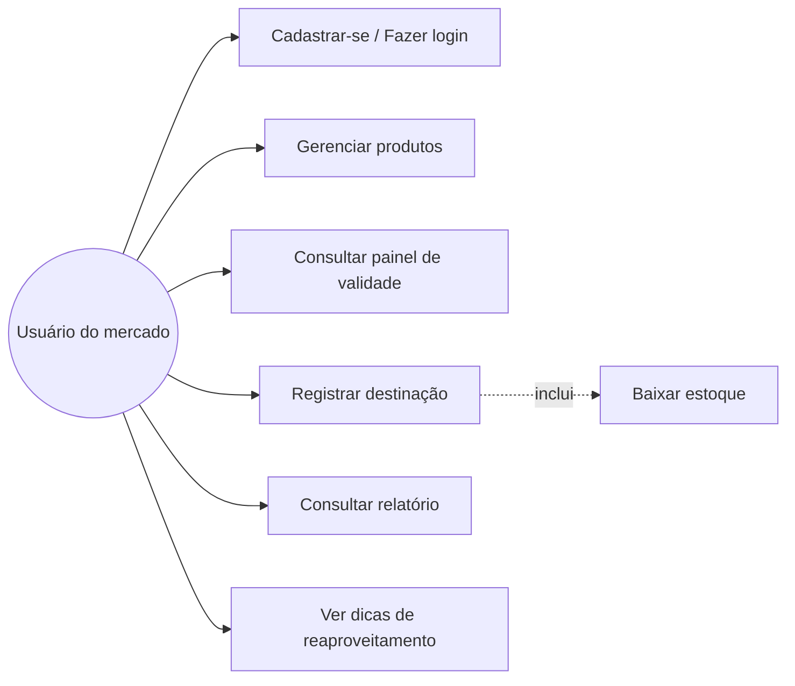
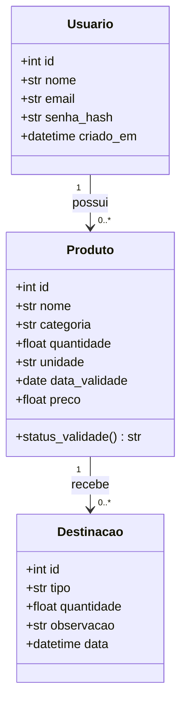
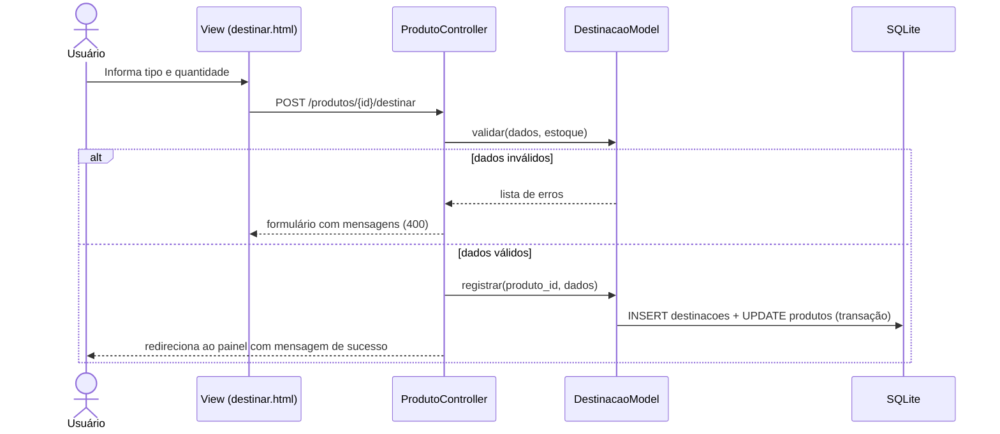
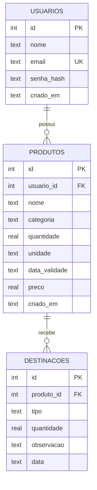

# Situação 1: Modelagem UML e de dados

> Os diagramas usam Mermaid, que o GitHub desenha automaticamente.

## Diagrama de casos de uso (resumo)

## Diagrama de classes (persistência)

## Diagrama de sequência: registrar destinação

## Modelo entidade-relacionamento (lógico, 3FN)

O projeto físico está em [`database/schema.sql`](../../database/schema.sql).
